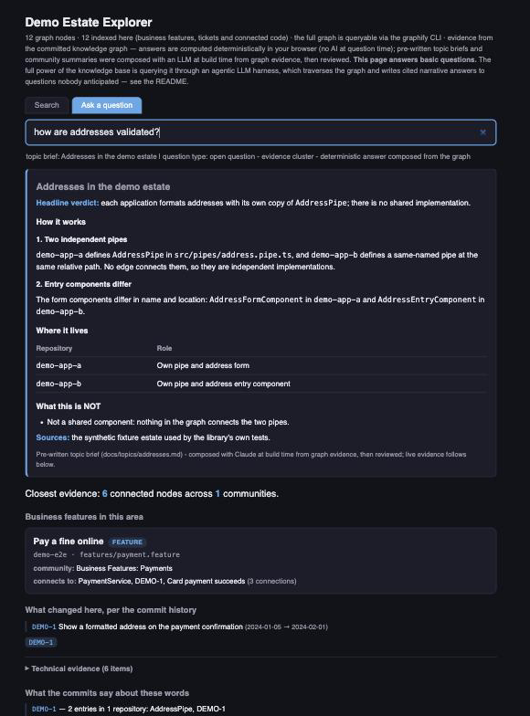

# knowledge-store-builder

Answers about your organisation's code, with a source for every answer. This
library builds a **knowledge store**: a Git repository of facts about a set of
repositories (their code structure, commit history, the tickets behind each
change, and reviewed written summaries). People then ask it questions in Claude
Code, GitHub Copilot or a browser.

- **Every answer cites its evidence:** a repository, a file path, a commit or a
  ticket id. Where the store has no evidence, the answer says so.
- **It answers across repositories:** which services implement something, who
  uses a component, and what a change could affect.
- **Askers need no build tools:** the store is committed files. The browser page
  works offline, with no licence and no server.

That is a real answer from the explorer page this repository's test store builds.
Two applications each have their own `AddressPipe`, and nothing links them, so the
store reports two separate implementations rather than guessing they are shared.

Asking questions of a store someone has built? You need the store, not this
library: see [Asking questions](docs/asking-questions.md).

## Build a store

You need Python 3.10 or later, Git 2.48 or later, the GitHub CLI, and access to
the repositories. The `knowledgestore` command runs a build one stage at a time:
it lists an organisation's repositories, clones them, extracts their code with
[graphify](https://github.com/safishamsi/graphify), joins files to the tickets
that changed them, and writes the page and indexes. `knowledgestore` with no
arguments lists the stages.

Start with [Creating a knowledge store](docs/creating-a-store.md), which takes
you from an empty repository to a published store.

## How it works

- A build writes static files, and the store commits them. Nothing is computed
  when someone asks, so answers come from evidence a person can open and check.
- The browser page runs no AI. Text an AI wrote during the build is reviewed and
  committed like any other file.
- Two builds from the same inputs produce identical files, so a store's changes
  can be reviewed as a diff.
- Commit history is kept beside the code graph rather than inside it, which keeps
  the graph small enough to load.

[How it works](docs/how-it-works.md) explains each mechanism and where its
behaviour is tested.

## Documentation

**Asking**

- [Asking questions](docs/asking-questions.md): Claude Code, Copilot, the browser, the terminal
- [`CHEATSHEET.md`](CHEATSHEET.md): every command, with nothing around it

**Building and running a store**

- [Creating a knowledge store](docs/creating-a-store.md): the step-by-step build
- [Refreshing a store](docs/refreshing-a-store.md): keeping one current
- [Configuring a store](docs/configuring-a-store.md): settings and stage outputs
- [Operator's notes](docs/building-a-knowledge-store.md): choosing what to include, costs, and known traps

**Background**

- [Grounding and verification](docs/grounding-and-verification.md): how answers stay tied to evidence
- [Retrieval architecture](docs/retrieval-architecture.md): how this differs from vector search
- [How it works](docs/how-it-works.md): each mechanism, its settings and its tests

## Contributing

[`CLAUDE.md`](CLAUDE.md) covers the development install, the checks a pull
request must pass, and the traps found so far.

## Licence

MIT. See [LICENSE](LICENSE).
